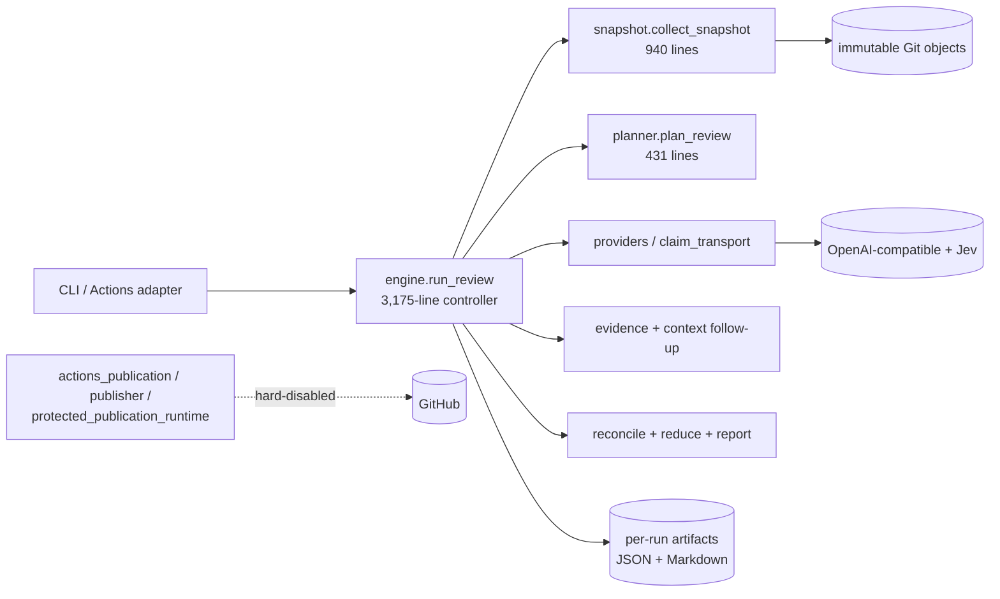
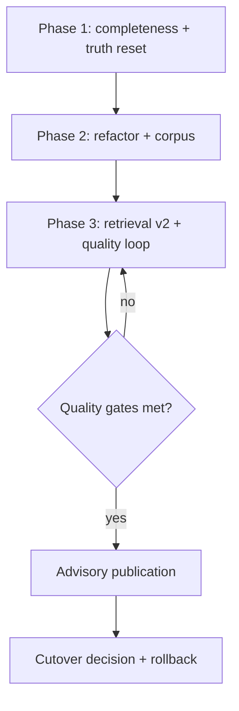
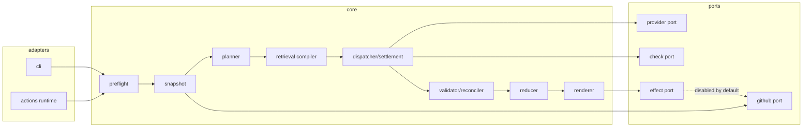

# Codebase assessment — PR Review Harness

**Assessment date:** 2026-11-01
**System revision:** `13e29d8` (main, after PRs #155 and #138)
**Method:** repository inspection, import/complexity analysis, coverage run, documentation and CI audit, GitHub governance queries. No provider calls, no target execution.
**Confidence:** medium-high on structure and engineering facts (measured); medium on quality claims (the project's own evidence is the only source); low on production behavior of the deployed target.

---

## Scope and confidence

Included: `src/pr_review_harness` (44 modules, 37,880 lines), `tests` (135 files, 81,072 lines), 71 script/helper files (62 Python), 25 Actions workflows, 88 top-level docs (4,862 lines) plus `docs/design/` and other subdirectories, 15 profile/limits files, packaging and release state.

Excluded: live provider behavior, target repository state (`magnus919/SlopSearX`), hosted runs, billing. Those are reported from project documents, not re-observed.

Evidence classes used below: **observed** (I measured it), **reported** (project docs/CI), **inferred** (reasoned from code), **unknown**.

---

## Executive assessment

This is an unusually disciplined five-week-old project. The safety and evidence machinery — deny-by-default effects, exact-byte request pinning, bounded budgets, fail-closed freshness, historical evidence preserved rather than rewritten — is unusually rigorous for a project this young. The deterministic control plane is real, tested, and honest about its own uncertainty.

But judged against its stated goal — a production-ready replacement for Droid's code-review function — the project is **not close**, and the gap is not primarily engineering polish. It is three things:

1. **The review engine does not yet complete a review.** The best natural run in the project's own record completed 27 of 42 required rows (64%); the common pattern is 16–23 of 42–44. A harness that usually says `INCOMPLETE` cannot replace a reviewer.
2. **Quality is unmeasured.** There are no human labels, no frozen labeled corpus, and no baseline comparison. Every semantic claim is correctly hedged, which is admirable, but it means the central product question is unanswered.
3. **Effort has drifted toward delivery plumbing.** The review core has been frozen since 2026-10-07 while subsequent work went into publication, canaries, and target cutover — publishing reviews whose completeness and accuracy are still unknown.

The strongest property is **evidence integrity**. The highest-risk property is **review completeness/quality**. The most urgent architectural risk is the 3,175-line `run_review` function, which makes the one thing that must improve hardest to change.

### Scorecard (against project goals)

| Dimension | Grade | Basis |
|---|---|---|
| Evidence discipline and claim honesty | **A** | Explicit unknowns, immutable pins, no model-as-truth, historical artifacts preserved (observed) |
| Effect safety and read-only boundaries | **A−** | Deny-by-default publication, fixed-arg git, budget ledgers; one HTTP-policy gap (below) |
| Deterministic control plane | **B+** | Real reducer/ledger/state tests; control logic concentrated in one unmaintainable function |
| Test depth | **B−** | 81.4% coverage, ~2.66k passing tests; weak on GitHub/publisher error paths, no types/property/mutation |
| Review completeness | **D** | Most observed reviews 36–64% of required rows complete; retrieval truncation systemic |
| Review quality evidence | **F** | Zero human labels, zero labeled corpus, no Droid baseline |
| Architecture maintainability | **D+** | Monolithic engine, duplicated orchestrators, contract/version sprawl |
| Operational/release readiness | **C−** | Strong CI mechanics; no releases, tags, license, changelog, or aggregated metrics |
| Documentation | **C** | Very rich, but contradictory and unindexed; 88 top-level docs, stale living documents |
| Governance | **D** | Single contributor, 0/20 recent merges with recorded review, no issue backlog, public repo without LICENSE |

---

## Evidence ledger

| ID | Claim | Class | Evidence | Confidence |
|---|---|---|---|---|
| E-001 | With `--ignore=tests/test_packaging.py`: 2,663 passed, 13 skipped; full local run adds 2 environment/order-dependent failures (missing `build`; one trial test that passes standalone). Line coverage 81.4% (19,691 statements) | observed | local `pytest --cov` on `13e29d8` | high |
| E-002 | `engine.run_review` is 3,175 lines with 15 nested functions and 607 branch nodes in its own body | observed | AST analysis, `engine.py:1370` | high |
| E-003 | 45 functions exceed 150 lines | observed | AST scan | high |
| E-004 | 107 `except Exception` sites in `src` (218 repository-wide); concentrated in trial/publisher modules (22 and 17) | observed | grep | high |
| E-005 | 187 of 267 Python files would be reformatted; CI runs `ruff check` only (E4/E7/E9/F/I) | observed | `ruff format --check`, `pyproject.toml`, `test.yml` | high |
| E-006 | 61 hard-coded SHA-256 values; 26 fixtures (1.1 MB) including frozen copies of `engine`, `providers`, `cli`, `selected_model_trial` | observed | grep, `tests/fixtures`, `frozen_runtime.py` | high |
| E-007 | Local retrieval results are capped at `max_output_bytes_per_task` (16 KB default) | observed | `engine.py:2771`; `profiles/ordinary-review-limits-v3.json` | high |
| E-008 | 8/8 context retrievals in the v17 PR305 run returned `ipc_envelope_truncated` | reported | `docs/CURRENT-STATUS.md` | medium-high |
| E-009 | Most natural reviews are INCOMPLETE/PARTIAL: 16/42, 19/43, 23/44, 27/42 required rows | reported | `CURRENT-STATUS.md`, `COMPLETE-REQUIREMENT-AUDIT-2026-10-01.md` | medium-high |
| E-010 | 25 workflows, 15 profile/limits files including eight SlopSearX generations (v9–v17, v15 absent) and three limits revisions, nine `run_*` entry points, 3 claim-assessment contract versions | observed | tree + grep | high |
| E-011 | README, `VERIFICATION.md` and `PUBLICATION-READINESS.md` contradict `CURRENT-STATUS.md` on publication and completion state | observed | document text | high |
| E-012 | 88 top-level docs, 4,862 lines, no index, 1 broken relative link; core last changed 2026-10-07 | observed | link scan, git log | high |
| E-013 | 238 PRs, one contributor, 0 issues, 0/20 most recent merged PRs have GitHub review records, public repo with no LICENSE | observed | `gh` API | high |
| E-014 | OpenAI-compatible provider accepts `http://` to any host; only the env helper rejects remote HTTP | observed | `providers.py:_safe_url`, `scripts/provider_config_from_env.py` | high |
| E-015 | `schemas/*.json` are not loaded by code or CI | observed | repository grep | high |
| E-016 | Lowest critical-path coverage: `github.py` 61.9%, `publisher.py` 71.0%, `checks.py` 74.3%, `cli.py` 76.2% (experiment modules are lower but outside the product surface) | observed | coverage JSON | high |
| E-017 | Evaluation toolkit is sophisticated but the bundled corpus has 1 case and 0 label packets | observed | `examples/evaluation/*` | high |
| E-018 | `pickle.dumps` is used purely as a size proxy for the claim assessor | observed | `engine.py:560` | high |
| E-019 | No tags, releases, changelog, SBOM, lockfile, SECURITY.md, CONTRIBUTING, CODEOWNERS, dependabot | observed | git + tree + GitHub API | high |
| E-020 | Source publisher is hard-disabled (`false &&`), while the target deployment reportedly runs DISPOSITION mode | observed / reported | `pr-publish.yml:79`; `CURRENT-STATUS.md` | high |

---

## What the system actually is

One process, no service, no database — a deliberate and good stateless choice. GitHub is the external system of record for publication. The core is stdlib-only; the single runtime dependency is optional (`PyJWT` for App auth). That is a genuine supply-chain advantage worth protecting.

The weak seam is not deployment shape; it is that **one function owns nearly the whole review lifecycle**. Everything else (snapshot, planner, providers, reconciler, reducer) plugs into it through dictionaries.

---

## Architecture characteristics

| Scenario | Characteristic | Current behavior | Evidence | Risk |
|---|---|---|---|---|
| Change the review flow | Modifiability | Any stage change edits a 3.2k-line function with shared closure state | E-002, E-003 | High: regressions, fear of change |
| Add a provider | Extensibility | Adapter classes OK, but orchestration duplicated across trial runners | E-010 | Medium |
| Run a review | Observability | Per-run JSON is rich and integrity-checked; cross-run aggregation absent | E-001, docs | Medium: no trend, no cost curve |
| Head moves mid-run | Freshness safety | Fail-closed STALE/UNKNOWN | tests/docs | Low |
| Provider timeout | Failure handling | Bounded, single-attempt by default, explicit incomplete | `limits-v3` (`max_retries_per_task: 0`) | Low, but no retry/backoff policy for transient 5xx |
| Change a pinned module | Maintainability | Historical fixtures must be added by hand; 10+ tests fail otherwise | E-006 (experienced with #138) | Medium-high: friction discourages refactoring |
| Grow the profile set | Configuration governance | 9 SlopSearX profile generations retained | E-010 | High: unclear which is authoritative |

---

## Coupling and modularity

| Candidate boundary | Static | Dynamic | Data | Change coupling | Verdict |
|---|---|---|---|---|---|
| Engine vs stages | Low cohesion inside one function; helpers are module-level but state flows through dicts | One call graph | Shared `result` dict mutated throughout | Any stage edit touches engine | **Needs seam work** |
| Trial runners vs core | `selected_model_trial`, `injection_trials`, `configured_jev_injection_trial`, `cross_model*`, `shadow_audit` each re-implement run/ledger/coverage logic | Independent entry points | Overlapping dict contracts | Fix in core does not propagate to trials | **Consolidate** |
| Publication vs core | Clear adapter boundary; `actions_publication` ↔ `protected_publication_runtime` 2-cycle | Explicit | Hashes/receipts | Publication evolves independently | Acceptable, break cycle |
| Profiles/limits vs code | Data-driven, but 3 limit sets and 9 profile versions | Runtime selection by CLI | Untyped JSON | Profile change may silently alter semantics | **Registry + deprecation** |
| Docs vs code | No generated status; manual narrative | None | None | Docs drift silently (E-011, E-012) | **Automate** |

**Decomposition readiness:** ready for a behavior-preserving internal refactor, not for service splitting. There is no independent scaling, ownership, or availability evidence that would justify new deployment units. The right move is a modular monolith with explicit stage interfaces.

---

## Data ownership and workflows

- **Authority:** Git objects and hashes are the source of truth for evidence; the run ledger/artifacts own review state; GitHub owns publication effects. This is coherent.
- **Invariants:** exact-byte request hashing, budget reservation before dispatch, blocker preservation, freshness gating. These are the project's crown jewels and are well tested.
- **Partial completion:** modeled explicitly (`INCOMPLETE`, `PARTIAL`, `UNKNOWN`). Better than most systems.
- **Reconciliation:** publication receipt/replay history is designed; hosted proof remains absent.
- **Weak point:** the same rigor is not applied to **review content completeness**. The system can prove it was incomplete but cannot yet make itself complete.

---

## Prioritized findings

### P0 — Review completeness is structurally capped

**Observed:** `engine.py:2771` sets the retrieval IPC envelope to `max_output_bytes_per_task` — 16 KB in the shipping limits — while per-task *input* is 96 KB. **Reported:** 8/8 retrievals returned `ipc_envelope_truncated` in the v17 run, and 7 follow-up proposals remained unresolved.

A file larger than 16 KB is truncated to a **prefix** (line 1..N), so the specialist may never see the function under review. This is a design mismatch — retrieved context is input, not model output — and it plausibly explains a large share of the persistent `CONTEXT_GAP_UNRESOLVED` rows and incomplete reviews. It is the single highest-leverage defect in the repository.

**Smallest safe step:** give retrieval its own envelope (≥ per-task input cap), add a regression test with a 40 KB file whose relevant symbol is at the end, and re-run the frozen PR305 case to measure the delta.

### P0 — Quality is unmeasured and the evaluation corpus is empty

**Observed:** `examples/evaluation` has 1 case and 0 labels (E-017). The evaluation toolkit is well specified (bounds, denominators, teacher/human separation) but unused. No Droid baseline exists.

Without labels you cannot choose a threshold, compare models, or justify cutover. "No human labels available" is treated as a permanent condition; it should be treated as a **blocking program risk** with an owner and a plan (even 30–50 maintainer-adjudicated cases are enough to start).

### P1 — The controller is a monolith

**Observed:** 3,175 lines, 15 nested functions, 607 branch nodes in its own body, 45 functions >150 lines (E-002, E-003). The review lifecycle, budget arithmetic, retries, follow-up scheduling, and reduction all live in one closure-heavy function. This is why changes are expensive and why trial runners were forked instead of extended.

**Ambitious but correct move:** extract a `RunState` dataclass and seven stage objects (preflight, snapshot, plan, dispatch, settle, reconcile, reduce/render) with byte-identical golden outputs. This is a behavior-preserving refactor, best done now while the output contract is stable.

### P1 — Experiment/production surface is blurred

**Observed:** nine `run_*` entry points, eight SlopSearX generations, 3 claim-assessment contracts, 25 workflows (E-010). Superseded trials remain importable and CI-tested. This multiplies maintenance and makes "the current behavior" ambiguous.

**Move:** freeze one review contract; move trials to `experiments/` outside the installable package or delete them; keep one supported profile and one limits set, plus archived read-only copies.

### P1 — Contradictory living documents

**Observed:** README and `VERIFICATION.md` say live publication is unavailable and retrieval is deferred; `PUBLICATION-READINESS.md` says **NO-GO**; `CURRENT-STATUS.md` reports a target deployment with DISPOSITION and posted reviews (E-011). All may be scoped differently, but a reader cannot tell. In a project whose product is evidence, this is a correctness bug in the product.

**Move:** one authoritative `STATUS.md` (scope, date, revision, decision per surface), an index for the other 87 docs, and archived historical checkpoints under `docs/history/`.

### P1 — Security boundary depends on the config path

**Observed:** `_safe_url` accepts `http://` for any host; only `scripts/provider_config_from_env.py` rejects remote HTTP (E-014). A hand-written `provider.json` with a remote `http://` base URL would send the bearer token in cleartext. Jev's transport already enforces HTTPS-or-loopback. Fix at provider construction, not at one helper, and test both paths.

### P1 — Release/governance hygiene

**Observed:** no LICENSE on a public repo, no tags/releases/changelog/SBOM/lockfile, no SECURITY.md, no dependabot, no recorded reviews on 0/20 recent merges (E-013, E-019). The CI is thorough (SHA-pinned actions, 4 Python versions, wheel/sdist, installed smoke) but there is no release artifact to consume.

### P2 — Test strategy bets too heavily on goldens

**Observed:** 61 hard-coded hashes and frozen copies of four large modules (E-006). Coverage is 81.4%, but `github.py` (61.9%) and `publisher.py` (71.0%) are the weakest critical paths (E-016). No type checking, no property tests, no mutation testing. The suite proves plumbing, not behavior under variation.

**Move:** keep a small, explicit compatibility suite for historical pins (with a documented refresh tool); add property tests for budgets/limits/state transitions; add mutation testing on reducer/validators; raise coverage on the error paths that matter.

### P2 — No aggregate observability or cost model

Per-run artifacts are rich, but there is no cross-run view of completion rate, failure reasons, latency, tokens, or cost. The project repeatedly reports "cost unknown" because billing is unavailable — a per-provider price table plus token counts would at least produce a bounded estimate and a trend.

---

## Ambitious improvement program (dependency-ordered)

The thesis: **stop expanding delivery; make one review genuinely usable, prove it with labels, then deliver it.**

### Phase 1 (foundation): stop the bleeding

| Work | Acceptance |
|---|---|
| Fix retrieval envelope; re-run PR305 | ≥80% of retrieval records complete (not truncated) on the frozen case |
| Freeze contracts: 1 review contract, 1 profile, 1 limits set | Old profiles archived, not selectable |
| Truth reset for docs: `STATUS.md` + index + archive | No contradictions across the top 5 docs; link check green |
| Security: HTTPS-or-loopback at provider construction; drop `pickle`; add LICENSE/ SECURITY/CHANGELOG | Tests for `http://remote` rejection on both config paths |
| CI: `ruff format --check`, bandit/CodeQL, link check, coverage report | All green on `main` |

### Phase 2 (evolvability and measurement)

| Work | Acceptance |
|---|---|
| Extract pipeline stages behind `RunState`; behavior-preserving | Golden outputs byte-identical; `run_review` <300 lines |
| Consolidate trial runners; delete superseded code | ≥25% reduction in `src` lines; one run path |
| Evaluation corpus v1: 30–50 frozen PRs, 2 repos, human-adjudicated severity labels, held-out split | `evaluate_reviews.py` runs in CI on change and on a fixed schedule; precision/recall lower/upper bounds published |
| Metrics: completion rate, reason distribution, latency, tokens, estimated cost | `pr-review stats` + a scheduled dashboard refresh |
| Typing: mypy/pyright on core stages | Strict on `engine` stages, `planner`, `contracts`, `reconcile` |

### Phase 3 (quality loop)

| Work | Acceptance |
|---|---|
| Retrieval compiler v2: AST/symbol windows, caller/callee closure, test discovery, chunked evidence with line anchors | ≥90% of required context obligations complete on the frozen corpus |
| Evaluation-driven prompt/model selection | Model/prompt changes gated by paired corpus comparison, not anecdotes |
| Droid baseline on the same snapshots | Paired report with identical cases and explicit denominators |
| Second project profile | End-to-end review with a second repository's conventions |
| Publication stays advisory/non-blocking until quality gates are met | Owner decision record with rollback |

### Phase 4 (after evidence): cutover decision

Only if Phase 3 acceptance holds: a risk-tiered gate (hard safety invariants cannot be averaged away), a rollback rehearsal, and an explicit owner decision. This matches `PRODUCTION-DELIVERY.md`'s existing gate structure; the missing piece is evidence, not design.

---

## Proposed target decomposition

The point is not microservices. It is **named stages with explicit state**, so the controller stops being a 3k-line closure and the trial forks stop being tempting.

---

## Metrics and proposed release gates

Owner must set the numbers; these are proposed starting points, not evidence:

| Metric | Proposed gate |
|---|---|
| Required-obligation completion on frozen natural corpus | ≥90% |
| Blocker recall (human-adjudicated, lower bound) | ≥0.80 |
| False-blocker rate (material, accepted) | ≤0.20 |
| Reviews returning `INCOMPLETE` | ≤15% |
| Unsafe effects / secret exposure in canary scans | 0 |
| p95 wall time per review | ≤10 min |
| Estimated cost per review | owner-set ceiling, tracked per run |
| Coverage (overall / core modules) | ≥85% / ≥90% |
| Type coverage of core | strict mypy on stages |
| Mutation score (reducer + validators) | ≥70% |

The important discipline: **hard safety invariants are vetoes, never averaged**; quality metrics are reported with denominators and uncertainty; model agreement is never accuracy.

---

## What to stop doing

1. **Stop adding trial workflows and profile generations.** Twenty-five workflows and eight profile generations is research thrift turning into maintenance debt.
2. **Stop expanding publication before review completeness is fixed.** Publishing a 40% incomplete review is not progress toward replacement.
3. **Stop treating "no human labels" as a permanent constraint.** Fund a small labeling program; it is the cheapest path to every quality decision.
4. **Stop maintaining 88 top-level living documents.** Keep ~10 current, archive the rest, and generate status from evidence.
5. **Stop merging without durable review records.** The project's own standard ("independent review clear") leaves no artifact on the PR.

---

## Unknowns

- Whether the deployed target's DISPOSITION mode currently posts accurate reviews (reported, not observed).
- Real provider cost, latency distribution, and failure rates.
- Whether the retrieval truncation is the dominant cause of incompleteness (strong inference; needs the frozen-case experiment).
- Human-judged defect prevalence in the historical corpus.
- Whether any external user depends on the public package (no releases, no issues, no license).

---

## Handoff

Architecture facts and the refactor plan are ready for an implementation-planning pass. API/contract changes belong with `api-design-and-evolution`; the evaluation corpus and grading belong with `agent-evals-and-observability`; release mechanics with `release-engineering`. No migration or publication action is proposed here beyond the already-authorized read-only work.

The actionable backlog derived from this assessment is in [docs/issues/README.md](issues/README.md), filed in GitHub as [#239–#271](https://github.com/groktopus/codereview/issues).
