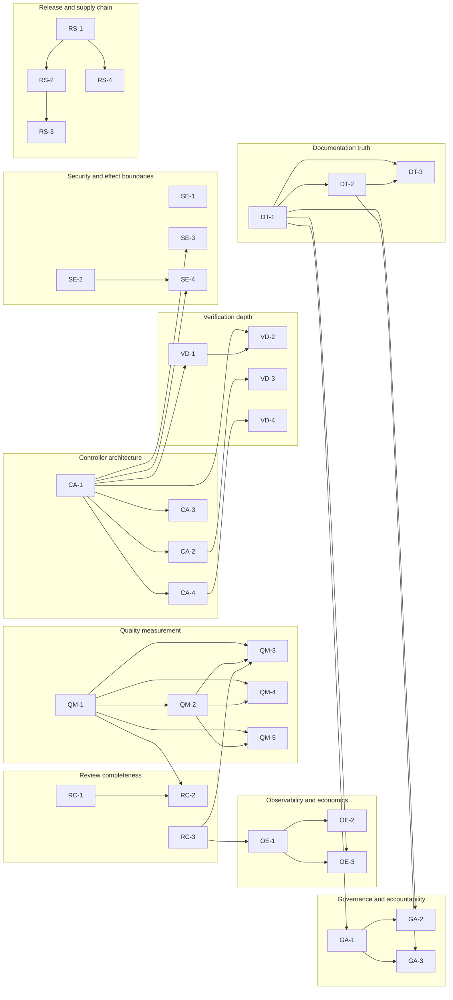

# Issue backlog — path to A−

**Created:** 2026-11-01
**Source:** [CODEBASE-ASSESSMENT-2026-11-01.md](../CODEBASE-ASSESSMENT-2026-11-01.md) at revision `13e29d8`
**Status:** filed in GitHub as issues [#239–#271](https://github.com/groktopus/codereview/issues). The mapping is recorded in [FILED.md](FILED.md). Every issue is independently scoped and reviewable.

This backlog converts the assessment's findings into themed work items. It deliberately contains **no dates or durations**: priority reflects dependency order and user impact, not scheduling. Each issue states the problem, the evidence, the substantive change, and an **observable exit criterion** that can be checked without judgment.

The target is **A− or better on every dimension of the assessment scorecard**, without regressing the two dimensions already at A/A− (evidence discipline and effect safety).

---

## What "A− across the board" means

These are proposed gates. The owner ratifies or changes the numbers; the method (observable, reproducible, denominator-bearing) is the point.

| Dimension | Current | A− exit evidence | Owned by |
|---|---|---|---|
| Evidence discipline | A | Every status claim carries revision, date, scope, and evidence link; automated freshness check fails on stale claims; zero unlabeled claims in the top-level docs | DT-3, OE-3, GA-1 |
| Effect safety | A− | One transport policy enforced at construction; zero high-severity SAST/secret findings; publication effect fault matrix and canary green | SE-1–SE-4 |
| Deterministic control plane | B+ | `run_review` ≤300 lines; one orchestrator; state machine and budget invariants covered by property tests; behavior-preserving golden output | CA-1, CA-2, VD-2 |
| Test depth | B− | Coverage ≥85% overall and ≥90% on `github`, `publisher`, `checks`, `actions_publication`; strict typing on core; mutation score ≥70% on reducer/validators | VD-1–VD-4 |
| Review completeness | D | ≥90% of required obligations complete on the frozen natural corpus; retrieval truncation ≤5%; `INCOMPLETE` rate ≤15% | RC-1–RC-3 |
| Quality evidence | F | ≥40 labeled cases across two repositories, held-out split, human-adjudicated; precision/recall bounds published with denominators; incumbent baseline on identical snapshots | QM-1–QM-5 |
| Architecture and modularity | D+ | One supported review contract, profile, and limits set; one run path; ≥25% reduction in `src` lines; no import cycles; typed module boundaries | CA-1–CA-4 |
| Operational and release readiness | C− | LICENSE; semver tags, changelog, SBOM, signed artifacts, reproducible install; cross-run metrics and cost model | RS-1–RS-4, OE-1–OE-3 |
| Documentation | C | One authoritative status document; indexed docs; zero contradictions and broken links; historical checkpoints archived | DT-1–DT-3 |
| Governance | D | 100% of merges carry recorded review evidence; decision records with named owners; CODEOWNERS and a triaged backlog | GA-1–GA-3 |

---

## Themes

| Theme | Issues | Why it exists |
|---|---|---|
| [Review completeness](01-review-completeness.md) | RC-1–RC-3 | The engine usually cannot finish a review; retrieval is capped and truncates context |
| [Quality measurement](02-quality-measurement.md) | QM-1–QM-5 | No labels, corpus, baseline, or regression gate for semantic quality |
| [Controller architecture](03-controller-architecture.md) | CA-1–CA-4 | One 3,175-line function and duplicated orchestrators make change expensive |
| [Verification depth](04-verification-depth.md) | VD-1–VD-4 | Tests prove plumbing; critical error paths, typing, and invariants are thin |
| [Security and effect boundaries](05-security-and-effect-boundaries.md) | SE-1–SE-4 | One transport policy gap; no SAST/threat model; effect faults under-tested |
| [Release and supply chain](06-release-and-supply-chain.md) | RS-1–RS-4 | Nothing is releasable: no license, tags, SBOM, or dependency lock |
| [Observability and economics](07-observability-and-economics.md) | OE-1–OE-3 | Per-run artifacts are rich, but there is no cross-run trend or cost model |
| [Documentation truth](08-documentation-truth.md) | DT-1–DT-3 | Living documents contradict each other and drift silently |
| [Governance and accountability](09-governance-and-accountability.md) | GA-1–GA-3 | Merges lack recorded review; decisions and ownership are implicit |

---

## Coverage map

Every scored dimension is covered by at least one P0 or P1 issue. Generated from each issue's `Dimensions` field; Security and Observability are tracked separately from the assessment's Effect safety and read-only boundaries and Operational/release readiness rows.

| Dimension | RC | QM | CA | VD | SE | RS | OE | DT | GA |
|---|---|---|---|---|---|---|---|---|
| Evidence discipline | ● |  |  |  |  |  | ● | ● | ● |
| Effect safety |  |  |  | ● | ● |  |  |  |  |
| Control plane | ● |  | ● | ● |  |  |  |  |  |
| Test depth |  |  | ● | ● | ● |  |  |  |  |
| Review completeness | ● | ● |  |  |  |  | ● |  |  |
| Quality evidence |  | ● |  |  |  |  |  |  |  |
| Architecture | ● |  | ● | ● | ● |  |  |  |  |
| Operational readiness |  |  |  | ● | ● | ● | ● |  | ● |
| Observability |  | ● |  |  |  |  | ● |  |  |
| Documentation |  |  |  |  |  |  | ● | ● | ● |
| Governance |  | ● | ● |  | ● | ● | ● | ● | ● |
| Security |  | ● |  |  | ● | ● |  |  |  |

---

## Dependency order

Edges are generated from each issue's `Depends on` field; the graph is acyclic. It is an ordering aid, not a schedule.

---

## Priority summary

| Priority | Issues | Meaning |
|---|---|---|
| P0 | RC-1, RC-3, QM-1, QM-2, CA-1, SE-1, DT-1, GA-1 | Contains an active correctness, truth, or trust defect, or unblocks measurement |
| P1 | RC-2, QM-3, QM-4, QM-5, CA-2, CA-3, CA-4, VD-1, VD-2, VD-3, VD-4, SE-2, SE-4, RS-1, RS-2, OE-1, OE-3, DT-2, DT-3, GA-2, GA-3 | Required for A− on its dimension |
| P2 | SE-3, RS-3, RS-4, OE-2 | Hardening and long-term operability; can follow the P1 path |

`RS-1` is P1 for the dimension gate but should be treated as immediate because the repository is public.

---

## Issue conventions

- **ID** is stable: theme prefix plus number. Do not renumber when closing.
- **Problem** must cite a revision, file/line, document, or measured result.
- **Exit criteria** must be observable: a metric, a test, a CI job, an artifact, or an external record. "Better" and "cleaner" are not criteria.
- **Verification** names the command or artifact that proves the exit criterion.
- **Depends on** lists only hard blockers. Soft ordering belongs in the dependency graph above.
- No issue may claim quality from model agreement, confidence, or a green transport test.

## Filing

All issues are filed as [#239–#271](https://github.com/groktopus/codereview/issues); [FILED.md](FILED.md) is the ID-to-URL map. Future findings use the same convention:

- title: `[<ID>] <title>`
- labels: `theme:<theme>`, `priority:<P0|P1|P2>`, `dimension:<name>`
- body: the issue section from the theme file, linked to this index.

Filing is idempotent by title prefix; re-running the filing step skips issues that already exist.

Open-issue states, state labels, owners, closure-evidence rules, and the
proposed mapping for the current 18 open issues are in
[Backlog triage](../BACKLOG.md). The checked snapshot is
[`backlog-open-issues.json`](../backlog-open-issues.json). Applying a state
label is an owner/root action; the filing step does not mutate existing issues.

The backlog is only "done" when every issue has an owner, a current state, and an evidence link, and the coverage map shows a credible path to each A− gate.

---

## Maintenance

- New findings enter as issues, not as new narrative documents.
- When an issue closes, record the evidence and update the coverage map.
- When the assessment is re-run, diff the scorecard; do not rewrite history in place.
- If an issue is abandoned, record why and which A− gate is now unreachable.
